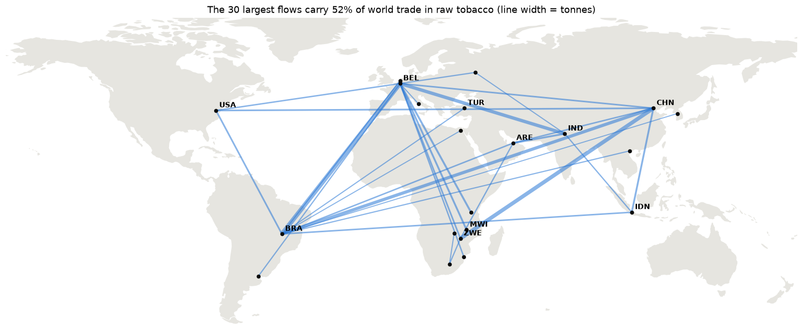
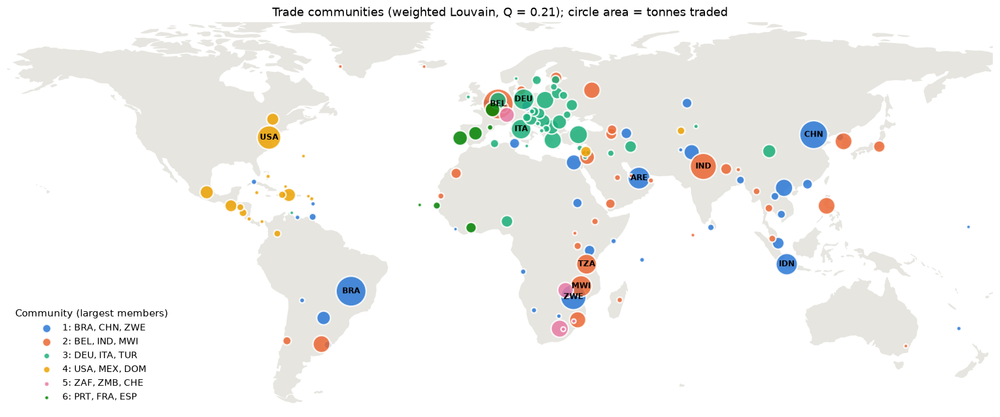

# The Global Trade Network of Raw Tobacco (2023)

Network analysis of every raw tobacco export reported to UN Comtrade for 2023: who supplies the world,
where the tobacco goes, which countries sit at the centre of the trade and whether the network splits into trading blocs.

**Tools:** Python · NetworkX · pandas · matplotlib



## Context

Individual project for the Network Optimisation and Social Networks course of the Master's in Data Analytics and Decision
Support Systems (ISCAC – Coimbra Business School), originally submitted in September 2024. This repository holds a revised version.
When I reviewed the original, I found that several measures had silently ignored the trade volumes and that two results had been misread.
The revision fixes both and adds new analysis.

## Data

- **Trade flows:** UN Comtrade, exports of *tobacco, partly or wholly stemmed or stripped* (HS 240120), 2023, all reporters and partners.
  After removing World aggregates, unspecified partners and one row without weight: **1,020 flows between 143 countries**.
- **Coordinates:** capital city of each country (SimpleMaps World Cities), used only to place countries on the maps.
- **Land outline:** Natural Earth 1:110m (public domain), via the `world-atlas` package.

## Main findings

- **Concentrated trade.** 1.45 million tonnes worth US$ 8.8 billion. Five exporters (Brazil, India, Zimbabwe, China, United States) supply 65% of the tonnes, and the 30 largest flows carry 52%.
- **A core and a periphery.** Tobacco circulates in both directions only within a core of 54 countries (67% of the tonnes). The other 89 countries sit at the end of the chain, and 82 of them only import, including large markets such as the UAE, Indonesia and Vietnam.
- **Distinct roles.** Producers act as hubs (Brazil, Zimbabwe, India). Belgium is the largest destination, importing 330 thousand tonnes and exporting 39 thousand. Germany, Italy and the US both import and export.
- **Wide price range.** Export unit values go from US$ 2.91/kg (Pakistan) to US$ 9.26/kg (United States), against a world average of US$ 6.03/kg.
- **Weak communities.** Weighted Louvain reaches a modularity of only 0.19–0.21 across 50 seeds. The network is organised around a few large suppliers and buyers rather than regional blocs.



## What changed from the original

| | Original | Revised |
|---|---|---|
| Edge weights | Column named `Weight`, so PageRank and Louvain (which look for `weight`) ignored the tonnes | Tonnes used in every weighted measure |
| Countries analysed | Only the 54-country strongly connected core, presented as removing "zero-eccentricity" nodes | Full network, with the core analysed explicitly |
| Connectivity | 90 strongly connected components read as 90 trading groups | One core of 54 countries plus 89 single countries |
| Communities | Unweighted Louvain, no modularity; share of cross-community links read as "density" | Weighted Louvain over 50 seeds, with modularity and share of tonnes inside communities |
| Interpretation | Clusters linked to lobbying networks without support in the data | Interpretation limited to what the data shows |
| New analysis | – | Trade concentration, HITS hubs and authorities, export/import ratios, export unit values |

## Limitations

The flows are exports as declared by exporting countries. Countries that do not report to UN Comtrade appear only as destinations,
and mirror data (imports declared by importers) was not used. The analysis covers a single year and a single product code.

## Repository structure

```
notebooks/tobacco_trade_network.ipynb   full analysis, from raw data to results
data/                                   UN Comtrade extract, country coordinates, land outline
figures/                                charts produced by the notebook
results/                                country metrics and communities (CSV)
requirements.txt
```

## How to run

```
pip install -r requirements.txt
jupyter notebook notebooks/tobacco_trade_network.ipynb
```

Run the notebook from the `notebooks` folder (it reads `../data`). It runs in under a minute.

## Sources

Natural Earth. (n.d.). *Admin 0 – Countries, 1:110m* [Data set]. https://www.naturalearthdata.com

SimpleMaps. (2024). *World cities database* [Data set]. https://simplemaps.com/data/world-cities

United Nations. (2024). *UN Comtrade database* [Data set]. https://comtradeplus.un.org
